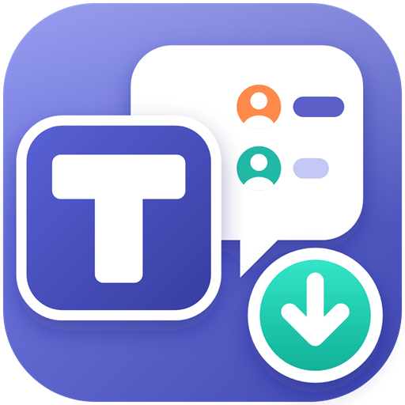
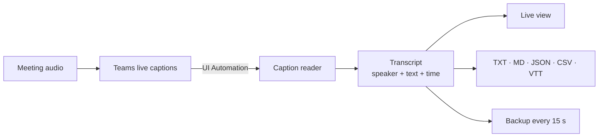

<div align="center">



# Teams Captions Saver

**Save Microsoft Teams live captions, with real speaker names, from the Teams desktop app.**

[](#requirements)
[](https://dotnet.microsoft.com/download/dotnet/10.0)
[](LICENSE)

</div>

---

Teams can show live captions during a meeting, but they disappear as soon as the meeting ends.
**Teams Captions Saver** runs next to the Teams desktop app, picks up every caption together with the
name of the person speaking, and saves the whole conversation as a transcript you can search, share
or paste into an AI tool for a summary.

You don't need a bot in the meeting, an admin to enable recording, or a cloud service. Everything
stays on your PC.

## Features

- 🎙️ **Real speaker names.** Each line shows who said it, taken directly from Teams.
- ⚡ **Live view.** Captions appear in the app as people speak and are corrected in place while the sentence is still being finished.
- 🗣️ **One paragraph per speaker.** Teams splits speech into many short captions; the app joins them back together, so each name and time appears once until someone else speaks.
- 📋 **Copy all.** One click copies the whole transcript, ready to paste into an email, notes or an AI tool.
- 🔎 **Filter and search.** Show only the speakers you pick, or only the lines containing a word (Ctrl+F). Copy all and Save then use just what's shown.
- ⭐ **Bookmarks and highlighter.** Star important lines (click ☆ or Ctrl+B) and highlight the exact words that matter. Saved transcripts start with a Highlights list.
- 🤖 **Hands-free.** Detects when you join a meeting, can switch Teams captions on for you, and saves when the meeting ends.
- 📄 **Five export formats:** plain text, Markdown, JSON, CSV (opens in Excel) and WebVTT subtitles.
- 💾 **Crash-safe.** A backup copy is written every 15 seconds, so a crash or reboot doesn't lose the meeting.
- ✏️ **Rename speakers.** Right-click to fix a name (for example a meeting-room account). The new name is remembered for future meetings.
- 🔒 **Private.** No network access, no audio recording, no admin rights.

## How it works

The new Teams client (`ms-teams.exe`) draws its interface with Microsoft Edge WebView2. WebView2 exposes
everything on screen through **Windows UI Automation**, the same accessibility API that screen readers
use. Teams Captions Saver reads the live-captions panel through that API about once a second.



Teams does the speech-to-text and knows who is talking, which is why the names are accurate. This app
records what Teams shows and keeps it.

## Getting started

### Requirements

- Windows 10 or 11
- The **new** Microsoft Teams desktop app
- [.NET 10 Desktop Runtime](https://dotnet.microsoft.com/download/dotnet/10.0), or use the self-contained build below

### Run it

1. Start **TeamsCaptionsSaver.exe**.
2. Join a meeting in the Teams desktop app.
3. Captions are switched on for you automatically. To do it yourself, go to **More (…) → Language and
   speech → Show live captions**.
4. The status turns green (**Capturing**) and the transcript fills in as people talk.
5. When the meeting ends, the transcript is saved to `Documents\Teams Transcripts`. You can also
   click **Save as…** at any time.

> **Tip:** The Teams window can sit behind other windows, but keep the captions switched on. If they're
> off, there is nothing for the app to record.

### Example output

```text
Meeting: Weekly sync
Date: Wednesday, October 14, 2026
Time: 10:00 - 10:32
Speakers: Alex Johnson, Sam Lee

[10:00:12] Alex Johnson: Morning everyone, let's start with the release checklist.
[10:00:19] Sam Lee: Sounds good. The build passed overnight, so we're ready for QA.
[10:00:31] Alex Johnson: Great. Any blockers before Friday?
```

## Settings

| Setting | What it does |
|---|---|
| **Save to** | Folder for transcripts (default `Documents\Teams Transcripts`) |
| **File name** | Pattern made from `{date}`, `{time}` and `{title}`, e.g. `2026-10-14_10-00_Weekly sync.txt` |
| **Formats** | Which formats to write when saving: TXT, MD, JSON, CSV, VTT |
| **Auto-save when the meeting ends** | Saves as soon as you leave the meeting |
| **Turn on Teams live captions automatically** | Switches on "Show live captions" when a meeting starts |
| **Auto-scroll** | Keeps the newest caption in view |

## Build from source

```bash
git clone https://github.com/mufeezahmad/TeamsCaptionsSaver.git
cd TeamsCaptionsSaver
dotnet build TeamsCaptionsSaver.sln
dotnet test TeamsCaptionsSaver.sln
```

Publish a single `.exe`:

```bash
dotnet publish TeamsCaptionsSaver.Desktop -c Release -r win-x64 --self-contained false -p:PublishSingleFile=true -o publish
```

To get an `.exe` that runs without .NET installed, use `--self-contained true` instead. The file is
about 150 MB.

To try the app without a meeting, start it with `--demo`. It shows a few made-up captions and doesn't
connect to Teams:

```bash
publish/TeamsCaptionsSaver.exe --demo
```

## Troubleshooting

<details>
<summary><b>Captions are showing in Teams, but the app says they're off</b></summary>

Microsoft may have changed how Teams lays out its captions. While captions are on screen, click
**Diagnostics**. The app writes what it can see in the Teams window to a text file; the line
`captions region:` says whether it found the captions. The matching rules are in
`Capture/CaptionParser.cs` and `TeamsCaptionReader.FindCaptionsContainer`.

The dump contains whatever is on screen in Teams (names, chat), so check it before sharing it.
</details>

<details>
<summary><b>Which versions of Teams are supported?</b></summary>

Only the **new** Teams desktop app (`ms-teams.exe`). Classic Teams and Teams in a browser are not
supported.
</details>

<details>
<summary><b>Where are logs and backups?</b></summary>

`%LOCALAPPDATA%\TeamsCaptionsSaver\`: `log.txt`, `settings.json`, and `backups\` (backups are kept
for 30 days).
</details>

## Project structure

```text
TeamsCaptionsSaver.Desktop/
├── Capture/
│   ├── TeamsCaptionReader.cs     Finds Teams windows, the meeting and the captions; turns captions on
│   ├── CaptionParser.cs          Turns a UI snapshot into (speaker, text) pairs
│   ├── UiNode.cs                 Snapshot of one UI Automation element
│   └── Native.cs                 Win32 window enumeration
├── Transcript/
│   ├── TranscriptSession.cs      Merges each scan into the transcript, without duplicates
│   └── TranscriptExporter.cs     TXT / MD / JSON / CSV / VTT
├── Models/                       Caption entry and settings
└── MainWindow.xaml(.cs)          UI, auto-save, backups and settings
TeamsCaptionsSaver.Tests/         Unit tests for parsing, merging and exports
```

## Privacy

Live captions can contain sensitive conversation. Transcripts are stored only on your PC, in the folder
you choose. The app never sends anything over the network. Follow your organisation's policies, and
tell the other participants when you're saving a meeting transcript.

## License

[MIT](LICENSE) © 2026 Mufeez Ahmad
